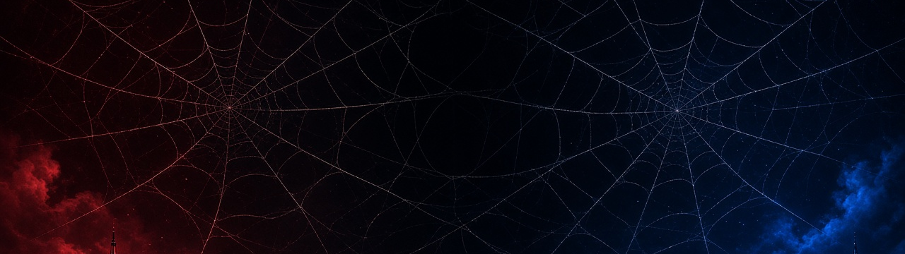

<div align="center">
  
  <br/><br/>
  <a href="https://github.com/fuzlik"></a>
  &nbsp;
  <a href="https://fuzlik.github.io/alabuga-it-landing/"></a>
  &nbsp;
  <a href="https://github.com/fuzlik/openclaw"></a>
</div>

<br/>

<table>
<tr>
<td width="70%" valign="middle">

### Hey — I'm Fuzlik

Frontend & agent tools. React / TypeScript / Vite. Ship clean UI from Figma, wire APIs, keep home agents running.

Currently into **[Alabuga IT landing](https://fuzlik.github.io/alabuga-it-landing/)** and a personal **[OpenClaw](https://github.com/fuzlik/openclaw)** setup.

```ts
const stack = ["React", "TypeScript", "Vite", "Node", "Figma"];
```

</td>
<td width="30%" align="center" valign="middle">
  
</td>
</tr>
</table>

<br/>

<p align="center">
  
  
  
  
  
</p>
