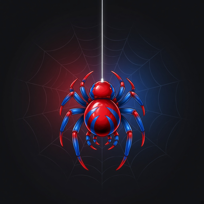

 

&nbsp;

&nbsp;

  

---

<table>
<tr>
<td width="68%" valign="top">

### 🕷️ With great power…

Привет! Я **Fuzlik** — собираю интерфейсы, агентов и тулзы, которые реально летают в проде.

- 🕸️ **Frontend** — React, TypeScript, Vite, pixel-perfect по Figma  
- 🤖 **Agents** — OpenClaw, OpenRouter, Telegram bots, home runbooks  
- 🏙️ **Product** — лендинги, формы, интеграции (Bitrix24 и дальше)

Люблю чистый UI, быстрые итерации и коммиты, от которых «spider-sense» не орёт.

</td>
<td width="32%" align="center" valign="middle">

</td>
</tr>
</table>

---

### 🧵 Tech web

  
  
  
  
  
  
  
  

---

### 🌆 Missions (pinned vibes)

| Project | What it does |
|:--------|:-------------|
| **[alabuga-it-landing](https://github.com/fuzlik/alabuga-it-landing)** | Лендинг Алабуга IT — Vite + React + TS, Express API, Bitrix24. [Live →](https://fuzlik.github.io/alabuga-it-landing/) |
| **[openclaw](https://github.com/fuzlik/openclaw)** | Home OpenClaw gateway: конфиг, runbook, Telegram, OpenRouter |

---

### 📊 Spider-sense stats

 

---

### 🕸️ Contribution web

 

**«Anybody can wear the mask. Can you wear the commit?»**

 

